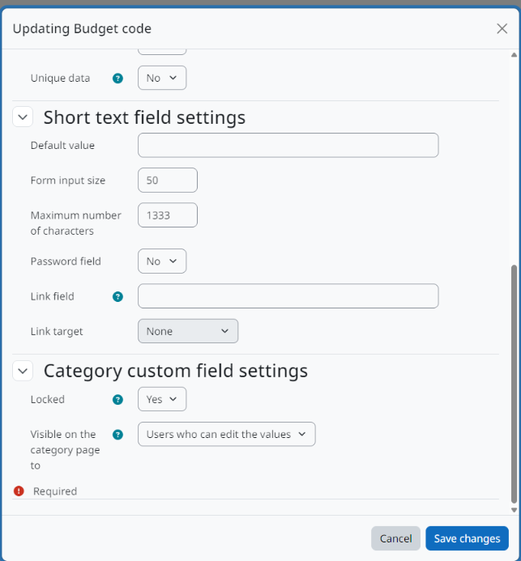

Configuração
============

Criando os campos
-----------------

Acesse *Administração do site > Cursos > Campos personalizados de categoria*. A página funciona como a dos campos personalizados do curso:

1. *Adicionar uma nova categoria* para agrupar os campos (cada grupo vira uma seção do formulário de edição).
2. *Adicionar um novo campo personalizado* e escolha o tipo: texto, área de texto, menu, caixa de seleção, data ou outro tipo instalado.
3. Preencha o nome, o nome breve (usado pelo web service), a descrição e as configurações do tipo.

   As configurações da área no fim do formulário do campo.

Configurações da área
---------------------

Bloqueado
   Só usuários com ``tool/categorycustomfields:changelockedcustomfields`` podem editar o valor.

Visível na página da categoria para
   * *Todos*: todos que podem ver a categoria, na página da categoria e pelo web service.
   * *Usuários que podem editar os valores*: só usuários com ``tool/categorycustomfields:edit`` na categoria.
   * *Ninguém*: o valor não aparece nem é devolvido pelo web service. Quem pode editar os valores continua vendo-o na página de edição.

Permissões
----------

``tool/categorycustomfields:configurecustomfields`` (sistema)
   Gerenciar os campos. Gerente, por padrão.

``tool/categorycustomfields:edit`` (categoria)
   Editar os valores de uma categoria e ver os campos visíveis a editores. Gerente, por padrão, e copiada de ``moodle/category:manage`` na instalação.

``tool/categorycustomfields:changelockedcustomfields`` (categoria)
   Editar campos bloqueados. Gerente, por padrão.
