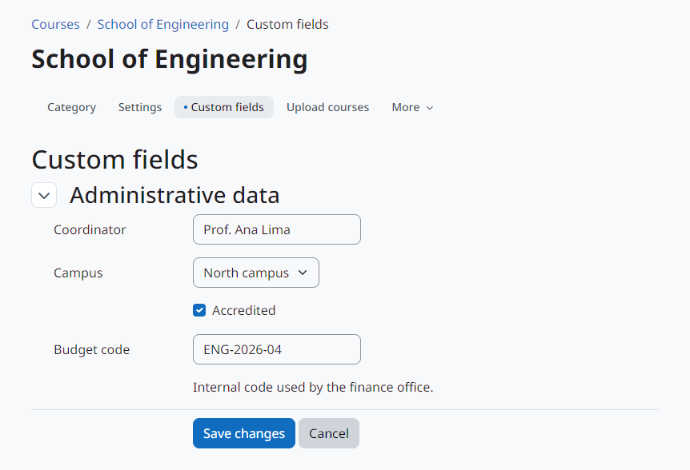

Uso
===

Editando os valores
-------------------

Abra a categoria (*Cursos > a categoria*) e, no menu da categoria, *Campos personalizados* (dentro de *Mais* quando o menu não couber). O formulário lista os campos que você pode editar, agrupados pela categoria de campos. Ao salvar, você volta à página da categoria.

   Editando os valores de uma categoria.

Na página da categoria
----------------------

Os valores visíveis para você aparecem junto à descrição da categoria, como uma lista de nomes e valores. Valores vazios não aparecem.

Web service
-----------

``tool_categorycustomfields_get_values`` recebe uma lista de ids de categoria e devolve, para cada categoria que o usuário pode ver, os campos que ele pode ver:

* ``shortname``, ``name`` e ``type`` do campo;
* ``value``: o valor gravado;
* ``displayvalue``: o valor formatado para exibição.

Categorias que não existem ou que o usuário não pode ver aparecem em ``warnings``. A função está disponível para chamadas AJAX e para o serviço do aplicativo Moodle; para usá-la com token, adicione-a a um serviço externo personalizado.

.. code-block:: bash

   curl "https://moodle.exemplo/webservice/rest/server.php?wstoken=TOKEN&moodlewsrestformat=json&wsfunction=tool_categorycustomfields_get_values&categoryids[0]=2"

Excluindo uma categoria
-----------------------

Quando uma categoria é excluída, os valores dela também são. Os campos continuam.
